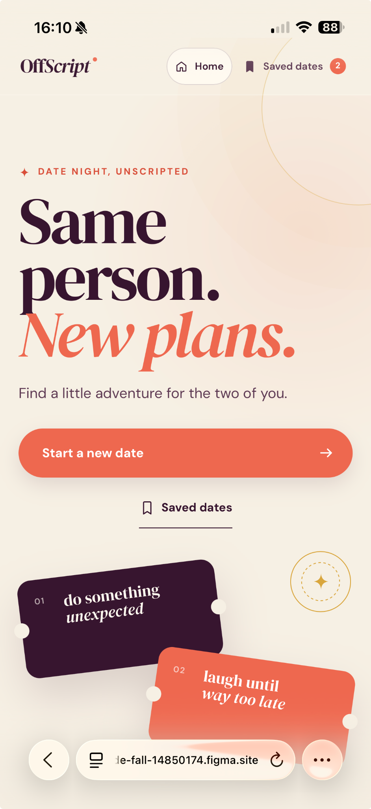

# OffScript

**Same person. New plans.** A shared-phone date planner for couples who want to break their routine without spending the evening deciding what to do.

[Try the live prototype](https://inside-fall-14850174.figma.site)

Created by **Laura Neugebauer** for Handshake AI Skills Studio × Figma’s **Turn Your App Idea into a Working Prototype** challenge. Submitted to Handshake Showcase on **November 13, 2026**. Competition result: pending; no award is claimed.

## Why I built it

My wife and I wanted more variety in our date nights. I chose a problem I understood personally: finding something enjoyable that fits both partners’ energy, mood, time, and budget. OffScript turns those choices into a specific plan with preparation and timed steps.

## Try it

1. Set your total budget, available time, and staying-in/going-out preference.
2. Optionally exclude food, outdoor activities, walking, shopping, or screens.
3. Complete the first check-in and pass the phone to your partner. Solo visitors can use a clearly labeled sample partner.
4. Reveal a matching date, try another idea, or adjust the evening.
5. Save a plan, reopen its instructions, and record completion and feedback.

## Features

- 36 curated dates spanning thoughtful, playful, creative, cozy, food, and outing experiences.
- Hard filtering by cost, duration, setting, activity exclusions, and the lower partner energy level; mood-based ranking.
- Suggestions rotate through eligible unseen ideas, with explicit one-match and exhaustion messages.
- Full saved plans, completion/undo, feedback, and shown-idea history stored in the same browser.
- Home, contextual Back controls, session-only Resume planning, and handoff restart confirmation.
- Responsive desktop/iPhone layouts and reduced-motion CSS.

## My contribution and AI assistance

I defined the product problem and requirements, directed the visual style, curated and refined the date concepts, and manually tested the published prototype on desktop Safari and iPhone Safari. Testing led to revisions to saved-plan access, suggestion feedback, Home navigation, and partner-answer privacy.

Figma Make generated and revised the application code using AI assistance. ChatGPT assisted with planning, prompts, QA guidance, and documentation. This is **not** presented as entirely hand-coded work. Automated checks reported by Figma Make are distinguished from my manual results and packaging checks in [QA evidence](docs/QA.md).

## Run locally

Use **Node.js 22.12+ within the Node 22 line** and **pnpm 10.34.3** (the exported toolchain specifies Node 22 and pnpm 10.34.3).

```sh
corepack enable
corepack prepare pnpm@10.34.3 --activate
pnpm install --frozen-lockfile
pnpm dev
```

Open the local address printed by Vite (default port **8443**).

```sh
pnpm exec tsc --noEmit
pnpm build
pnpm preview
node scripts/check-date-library.mjs
```

No API key, login, backend, or environment file is needed. The Figma site metadata is retained because `vite.config.ts` imports it. The original Figma-specific configuration and source are included unchanged.

## Stack and structure

React 19 · TypeScript · Vite 8 · Tailwind CSS 4 · localStorage

```text
src/App.tsx           UI, navigation, matching, saved plans
src/dateIdeas.ts     Typed curated date collection
src/index.css        Responsive styles and typography
src/main.tsx         React entrypoint
public/favicon.png  Exported app icon
.figma/make/         Exported Figma build/site configuration
```

## Scope and limitations

- This is a functional prototype using deterministic rules, **not a runtime AI generator**.
- Saved plans/history stay in one browser and origin; no device sync or recovery after clearing site data.
- Unfinished setup/check-ins and Resume planning are in memory and do not survive a refresh.
- Hiding check-ins during the handoff is a UI behavior, not encrypted storage or authentication.
- Prices and durations are estimates. No live weather, maps, venue availability, or price verification.
- Google Fonts are requested by the stylesheet; system fallbacks apply if unavailable. Full offline/PWA support is not claimed.
- The current storage helper catches read/write errors silently and does not validate parsed shapes. Malformed stored records and an explicit storage-unavailable notice remain hardening work.
- A full accessibility audit and exhaustive browser-history testing have not been completed.

## Project records

- [Case study](docs/CASE_STUDY.md)
- [QA evidence and manual test record](docs/QA.md)
- [Bug and iteration log](docs/BUG_LOG.md)
- [Submission snapshot and packaging changes](docs/SUBMISSION.md)
- [Review handoffs for Andi and Dex](docs/HANDOFFS.md)

<details>
<summary>iPhone home screenshot</summary>



</details>

## Reuse

No new blanket open-source license has been assigned. Review provenance and applicable Figma/export and third-party terms before redistributing or relicensing. Dependency licenses remain with their respective authors.
